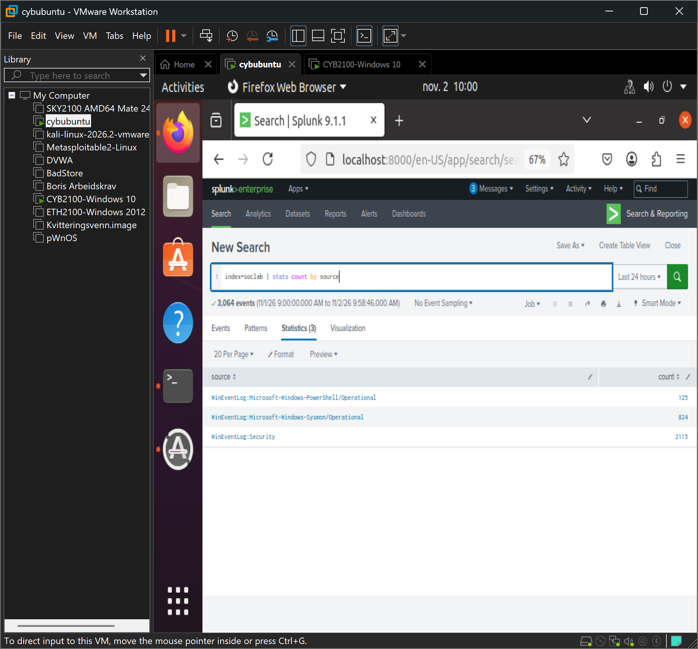

# SOC Detection Lab

Et eget SOC-laboratorium der jeg samler inn Windows-logger i Splunk, simulerer angrep og skriver en analyse (writeup) for hvert av dem. Jeg bygde dette ved siden av cyberstudiet for å øve på praktisk deteksjonsarbeid.

## Lab-arkitektur

| Maskin | Rolle | OS | IP |
|---|---|---|---|
| Windows 10 | Endepunkt (overvåkes) | Windows 10 | 192.168.12.137 |
| Cybubuntu | SIEM | Ubuntu | 192.168.12.129 |

Windows-maskinen kjører Sysmon (SwiftOnSecurity-konfig) og en Splunk Universal Forwarder som sender Security-, Sysmon- og PowerShell-logger til Splunk på port 9997, til indeksen `soclab`.

## Verktøy

- **Splunk Enterprise** – SIEM for søk og analyse av loggene
- **Sysmon** – detaljert prosess- og nettverkslogging på Windows
- **Splunk Universal Forwarder** – sender loggene fra endepunktet til Splunk
- **VMware Workstation** – virtualiseringsmiljøet
- **MITRE ATT&CK** – rammeverk for å klassifisere teknikkene

## Writeups

| # | Writeup | Angrep | ATT&CK |
|---|---|---|---|
| 00 | [Oppsett av lab-miljøet](writeups/00-oppsett.md) | – | – |
| 01 | [Brute force-deteksjon](writeups/01-bruteforce.md) | Brute force mot Administrator | T1110 |
| 02 | [Ny admin-bruker](writeups/02-ny-admin-bruker.md) | Opprettelse av bakdør-bruker | T1136.001, T1098 |
| 03 | [Kodet PowerShell](writeups/03-kodet-powershell.md) | Skjult PowerShell-kommando | T1059.001 |

## Planlagt videre

- Portskanning fra Kali og deteksjon på nettverksnivå
- Lagrede varsler (alerts) og et dashbord i Splunk
- Berikelse av varsler med trusseletterretning (kjente ondsinnede IP-er og domener)

---

Bygget mens jeg studerer cybersikkerhet ved Høyskolen Kristiania.
