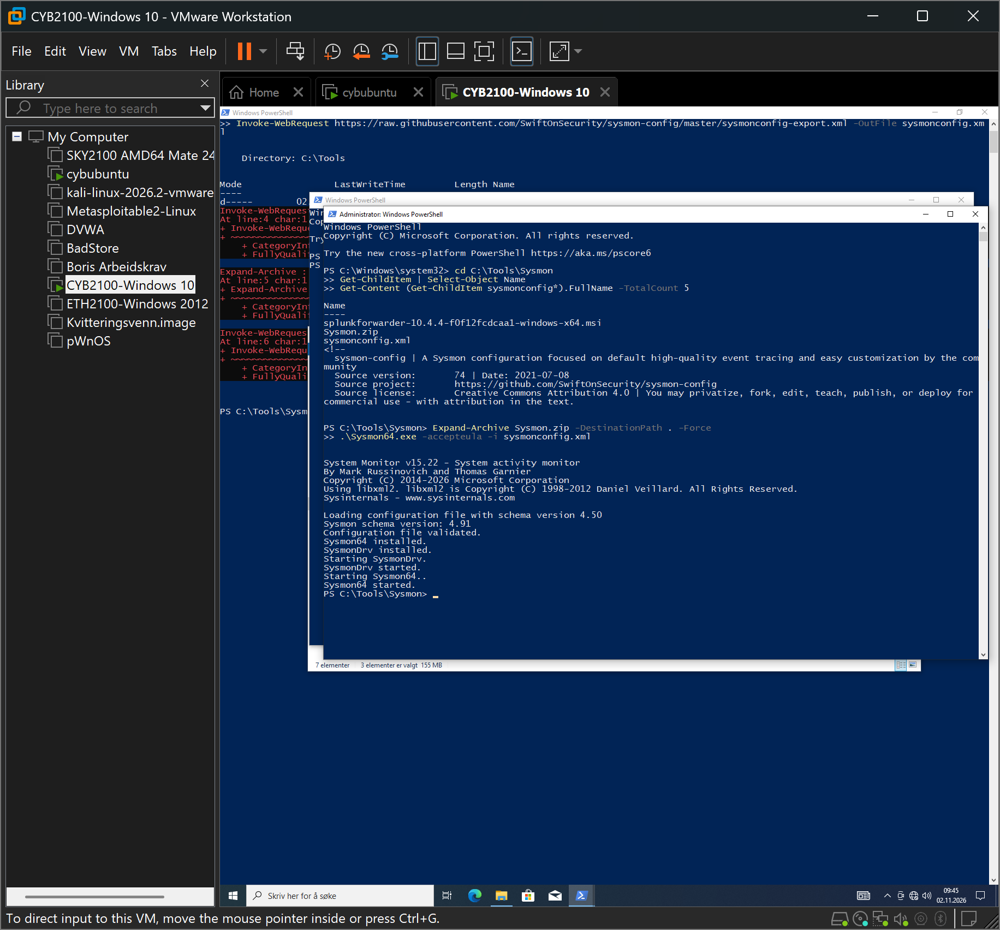

# 00 – Oppsett av lab-miljøet

## Mål

Bygge et miljø der Windows-logger samles inn i Splunk, slik at jeg selv kan simulere angrep og øve på å oppdage dem.

## Steg

1. **Splunk** installert på Ubuntu (Cybubuntu), satt til å ta imot logger på port 9997, med en egen indeks `soclab`.
2. **Sysmon** installert på Windows med SwiftOnSecurity sin konfigurasjon, for detaljert prosess- og nettverkslogging.
3. **Windows-logging** slått på for pålogginger, brukerkontoer, gruppeendringer og PowerShell (ScriptBlockLogging).
4. **Universal Forwarder** installert på Windows, satt til å sende Security-, Sysmon- og PowerShell-loggene til `soclab`.



## Resultat

Et søk i Splunk bekreftet at loggene kom inn fra alle tre kildene:

```spl
index=soclab | stats count by source
```

- WinEventLog:Security
- WinEventLog:Microsoft-Windows-Sysmon/Operational
- WinEventLog:Microsoft-Windows-PowerShell/Operational
