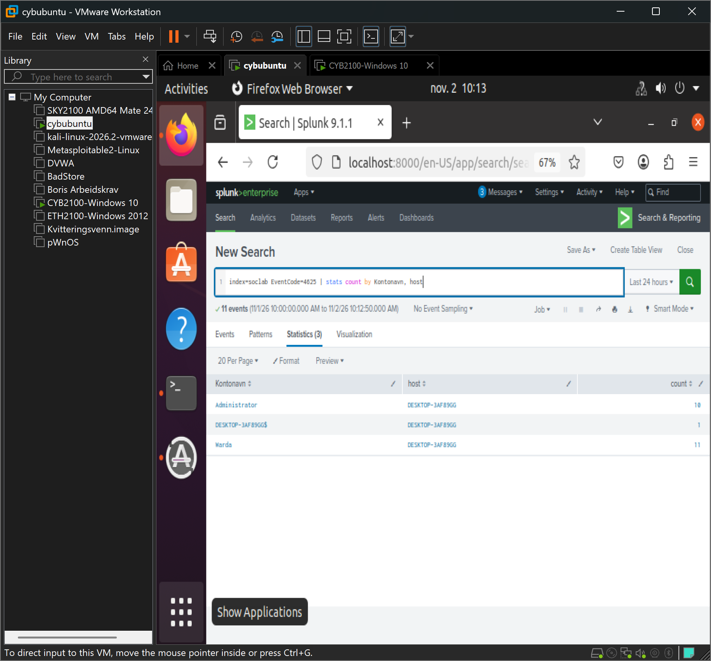

# 01 – Brute force mot Administrator (T1110)

## Scenario

Jeg simulerte 20 påloggingsforsøk med feil passord mot den lokale Administrator-kontoen på Windows-maskinen, for å etterligne et automatisert passordangrep.

## Deteksjon i Splunk

Mislykkede pålogginger logges som Event ID 4625. Loggene var på norsk, så standard feltnavn som `Account_Name` ga ingen treff. Jeg undersøkte hendelsene og fant at brukernavnet lå i feltet `Kontonavn`.

```spl
index=soclab EventCode=4625 | stats count by Kontonavn, host
```

Søket viste 10 mislykkede pålogginger mot Administrator fra samme maskin, på få sekunder.



## Analyse

- **Varsel:** 10 mislykkede pålogginger (4625) mot Administrator.
- **Alvorlighet:** Middels til høy. Angrepet retter seg mot administratorkontoen, som gir full kontroll hvis det lykkes.
- **Konklusjon:** Ekte forsøk på brute force. Ingen av forsøkene lyktes (ingen Event ID 4624 for Administrator).
- **Tiltak:** Sperre kontoen midlertidig, blokkere kilden, og vurdere en kontolåsingsregel etter flere mislykkede forsøk.

## MITRE ATT&CK

T1110 – Brute Force
