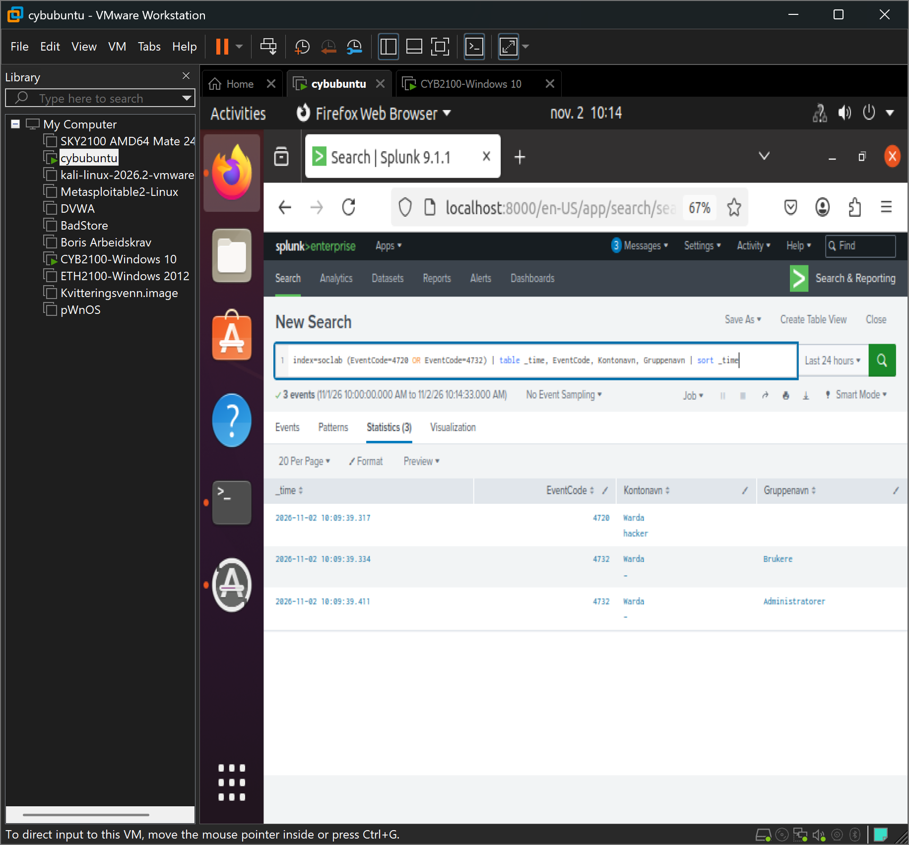

# 02 – Opprettelse av bakdør-bruker (T1136.001, T1098)

## Scenario

Jeg opprettet en ny lokal bruker, «hacker», og la den i administratorgruppen. Dette etterligner en angriper som sikrer seg varig tilgang (persistens) etter å ha kommet seg inn.

## Deteksjon i Splunk

Opprettelse av bruker logges som Event ID 4720, og tillegg til en gruppe som Event ID 4732.

```spl
index=soclab (EventCode=4720 OR EventCode=4732) | table _time, EventCode, Kontonavn, Gruppenavn | sort _time
```

Søket viste at «hacker» ble opprettet (4720) og lagt i gruppene Brukere og Administratorer (4732), alt innen ett sekund. Et så raskt forløp tyder på et skript, ikke manuell administrasjon.



## Analyse

- **Varsel:** Ny bruker «hacker» opprettet og gitt administratorrettigheter.
- **Alvorlighet:** Høy. En ukjent konto med admin-rettigheter er en typisk bakdør.
- **Konklusjon:** Ekte ondsinnet handling. Klart tegn på forsøk på persistens.
- **Tiltak:** Deaktivere og slette brukeren, undersøke hvordan den ble opprettet, se etter andre nye kontoer, og vurdere å isolere maskinen.

## MITRE ATT&CK

T1136.001 – Create Account: Local Account
T1098 – Account Manipulation
