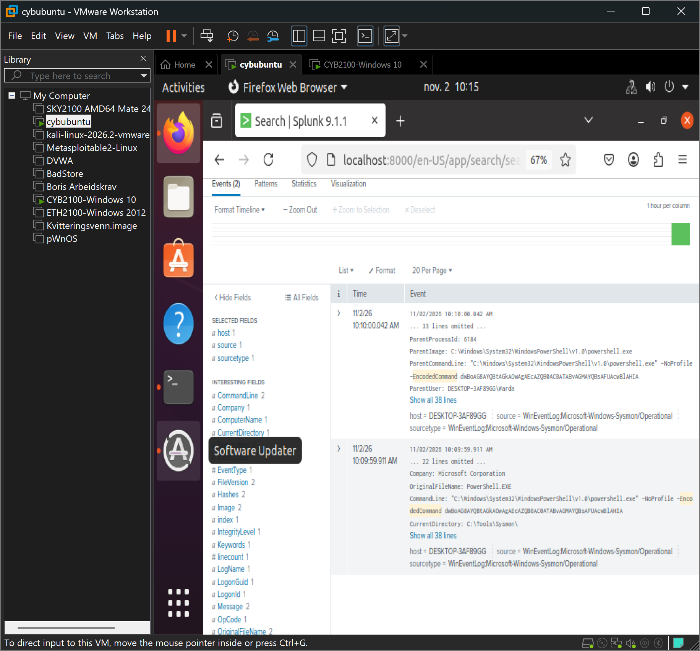

# 03 – Skjult (kodet) PowerShell-kommando (T1059.001)

## Scenario

Jeg kjørte en Base64-kodet PowerShell-kommando med parameteren `-EncodedCommand`. Angripere bruker ofte koding for å skjule hva kommandoen faktisk gjør.

## Deteksjon i Splunk

Sysmon logger prosessoppstart som Event ID 1, med hele kommandolinjen.

```spl
index=soclab EventCode=1 "EncodedCommand"
```

Søket viste powershell.exe kjørt med `-EncodedCommand`. Da jeg dekodet strengen, inneholdt den kommandoene `whoami` og `Get-LocalUser`, altså rekognosering: angriperen kartlegger hvem de er og hvilke brukere som finnes på maskinen.



## Analyse

- **Varsel:** powershell.exe med `-EncodedCommand`.
- **Alvorlighet:** Middels til høy. Koding brukes for å skjule innhold og unngå enkel deteksjon.
- **Konklusjon:** Ekte mistenkelig aktivitet. Tegn på at angriperen utforsker systemet.
- **Tiltak:** Dekode og analysere kommandoen, undersøke hvilken prosess som startet PowerShell, og sørge for at PowerShell-logging (ScriptBlockLogging) er på.

## MITRE ATT&CK

T1059.001 – Command and Scripting Interpreter: PowerShell
